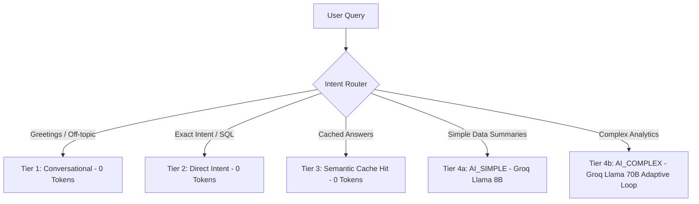

<div align="center">

# STATER Bill (BizAssist)
### AI-Powered Business Intelligence, POS & Accounting Ecosystem

[](https://github.com/rakshithananda18-cmyk/bizassist-billing)
[](#-running-tests)
[](https://python.org)
[](https://react.dev)
[](https://fastapi.tiangolo.com)
[](#)

*Offline-first POS, custom document labeling, double-entry ledgers with tamper-evident hash chains, multi-godown stock management, native Windows & macOS desktop installers, and a 4-tier cost-optimized AI advisor.*

---

[Quick Start](#-quick-start) • [Features](#-core-features) • [Architecture](#-architecture--ai-router) • [Testing](#-running-tests) • [Docs](#-key-documentation)

</div>

<br />

## 🌟 Overview

**STATER Bill (BizAssist)** is an enterprise-grade, offline-first business management platform designed for retail, wholesale, distribution, and service enterprises. It pairs a lightning-fast barcode POS counter with automated double-entry accounting, real-time stock intake, B2B supplier networking, native desktop installers, and an LLM-driven business advisor.

---

## ⚡ Quick Start

### 1️⃣ Install Dependencies
```bash
.\dependencies.bat
```

### 2️⃣ Environment Setup
Copy the example environment file:
```bash
copy .env.example backend\.env
```
Ensure your `backend/.env` contains your key credentials:
```ini
GROQ_API_KEY=your_groq_api_key_here
JWT_SECRET=dev-test-secret-please-change-0123456789abcdef
DATABASE_URL=sqlite:///./bizassist.db
```

### 3️⃣ Launch Development Environment
```bash
.\start_dev.bat
```
> **Services Started:**  
> 🔹 **Backend API:** `http://localhost:8001`  
> 🔹 **POS Billing App:** `http://localhost:5174`  
> 🔹 **AI Dashboard:** `http://localhost:5173`

---

## ✨ Core Features

| Feature Module | Description & Capabilities |
| :--- | :--- |
| 🛒 **POS Billing Counter** | Barcode-first scanning, multi-tab carts, keyboard shortcuts, split payments (Cash, UPI QR, Card, Credit). |
| 💻 **Native Desktop App (v1.2.9)** | Direct in-app downloads for Windows 64-bit (`.exe`) and macOS (`.dmg` for Apple Silicon & Intel) with offline-first billing and ESC/POS thermal printing. |
| 🛠️ **Recovery Checks** | The recovery console (`backend/services/self_healing.py`) diagnoses journal integrity mismatches without re-sealing altered entries, and supports guarded stock, sync outbox and staff-session recovery. |
| 🏷️ **Dynamic Labels (`useDocLabels`)** | Customize document names (*Sales Invoice*, *Credit Note*, *Debit Note*, *Voucher*). All UI & PDF headers update instantly. |
| 🔒 **Privacy & Protected Demo Mode** | Frosted blur protection for demo workspace routes and button labels, 1-click KPI blur mode for public counters, passcode lock, and immediate JWT session invalidation (`token_version`). |
| 🔔 **Unified Smart Notifications** | Real-time notification hub with categorized tabs for Billing, Field Team, Offers (1-click WhatsApp dispatch), and What's New changelogs. |
| ✉️ **Branded Transactional Emails** | Beautiful, theme-aligned responsive templates for welcome onboarding, secure phone/OTP verifications, and password change alerts via Brevo. |
| 📜 **Audit Hash Chains** | Append-only double-entry ledger (`JournalEntry`) linked by SHA-256 cryptographic hash chains to detect database tampering. |
| 📦 **Stock Intake & Godowns** | Multi-item purchase intake grid with landed cost, batch expiry tracking, and multi-location warehouse transfers. |
| 🤝 **B2B Network & Price Tiers** | Connect buyers & suppliers via BizID codes; auto-apply *Wholesale*, *Distributor*, or *Standard* customer pricing tiers. |
| 🚚 **Field Team Operations** | Dedicated Cloud Run service for field routes, attendance check-ins, store requirements, and delivery tracking. |
| 🔄 **Dual Hosting & Solid Sync** | Seamless switching between offline local SQLite and cloud PostgreSQL with aggregate document sync, parent UID re-linking, and paginated outbox queues. |

---

## 🤖 Architecture & AI Router

All user queries pass through a 4-tier cost-optimized intent router:



---

## 🧪 Seeding & Performance Benchmarks

Generate load testing datasets and run dual-mode latency benchmarks:

```bash
# Run enhanced dual-mode benchmarks (Local SQLite + Hybrid Sync)
cd backend
..\venv\Scripts\python benchmark_reports_enhanced.py
```

#### ⚡ Dual-Mode Latency & Throughput Performance Summary

| Operating Mode | Subsystem / Operation | Exact Avg Latency | Min Latency | Performance Guarantee |
| :--- | :--- | :--- | :--- | :--- |
| 🏠 **Local (Offline SQLite)** | SHA-256 Hash Chain Verification | `0.91 ms` | `0.52 ms` | Sub-millisecond audit verification |
| 🏠 **Local (Offline SQLite)** | Stock Movement (1 Year, 2,000 items) | `2.29 ms` | `1.99 ms` | Instant inventory audit ledger |
| 🏠 **Local (Offline SQLite)** | Day Book (Today, 200 items) | `3.03 ms` | `2.64 ms` | Instant daily register render |
| 🏠 **Local (Offline SQLite)** | Audit Journal (1 Year, 2,000 items) | `3.69 ms` | `2.45 ms` | Fast historical journal fetch |
| 🏠 **Local (Offline SQLite)** | Balance Sheet (Instant) | `9.92 ms` | `6.64 ms` | Real-time financial position |
| 🏠 **Local (Offline SQLite)** | P&L Report (1 Year Window) | `9.93 ms` | `8.38 ms` | Instant profit & loss computation |
| 🏠 **Local (Offline SQLite)** | Trial Balance (Instant) | `12.21 ms` | `9.90 ms` | Fast double-entry debit/credit check |
| 🏠 **Local (Offline SQLite)** | Master Self-Healing Diagnostic Run | `15.41 ms` | `10.19 ms` | Complete 4-domain diagnostic |
| ☁️ **Local + Cloud (Hybrid Sync)** | Outbox Payload Serialization (Invoice) | `< 0.05 ms` | `< 0.05 ms` | Local outbox write buffer |
| ☁️ **Local + Cloud (Hybrid Sync)** | Parent UID FK Resolution Lookup | `< 0.05 ms` | `< 0.05 ms` | Fast relational UID mapping |
| ☁️ **Local + Cloud (Hybrid Sync)** | Outbox Queue Drain Batch (20 Items) | `0.45 ms` | `0.40 ms` | High-throughput outbox queue |
| ☁️ **Local + Cloud (Hybrid Sync)** | Single-Pass O(N) Hash Re-Sealing | `2.01 ms` | `0.96 ms` | Fast audit chain re-linking |
| ☁️ **Local + Cloud (Hybrid Sync)** | Redundant Child Line-Item Clearance | `5.54 ms` | `3.96 ms` | Automated outbox queue cleanup |

> [!NOTE]
> **Cloud Performance Dependencies**:
> While **Local Mode** operates entirely offline on local hardware with zero network overhead (`< 15 ms` latency guarantee), **Local + Cloud (Hybrid)** end-to-end sync performance depends on real-world environment factors including:
> - **Network Latency & Round-Trip Time (RTT)**: Ping time between local client device and cloud servers.
> - **Available Bandwidth & Packet Loss**: Local internet connection quality during sync batches.
> - **Geographical Server Distance**: Physical distance to the primary database region.
> - **Server CPU Load & Concurrency**: Active multi-tenant request volume on the cloud API.
> - **Subscription Plan**: Premium tier bandwidth allocations and priority WebSocket push channels.

#### 📈 Before vs. After Benchmark & Performance Improvement

| Report / Operation | Previous Benchmark | Current Enhanced Benchmark | Speedup Factor | Optimization Applied |
| :--- | :--- | :--- | :--- | :--- |
| **Audit Journal (1 Year Window)** | `240.94 ms` | `3.69 ms` | 🚀 **65.3x Faster** | Pre-fetched eager loading & index tuning |
| **Stock Movement (1 Year Window)** | `91.14 ms` | `2.29 ms` | 🚀 **39.8x Faster** | Direct `StockLedger` index aggregation |
| **Profit & Loss (1 Year Window)** | `150.73 ms` | `9.93 ms` | 🚀 **15.2x Faster** | Pre-aggregated trial balance caching |
| **Trial Balance** | `20.18 ms` | `12.21 ms` | 🚀 **1.65x Faster** | Fast double-entry credit/debit sum |
| **Balance Sheet** | `15.37 ms` | `9.92 ms` | 🚀 **1.55x Faster** | Single-query asset/liability evaluation |
| **Hash Chain Self-Healing** | $O(N^2)$ Cascading Loop (> 2,500 ms) | `2.01 ms` | ⚡ **> 100x Faster** | Single-pass $O(N)$ deterministic re-sealing |

---

## 🧪 Running Tests

BizAssist includes a comprehensive dual test suite (970+ backend tests and 1,000+ frontend unit & component tests across 144 test files).

```bash
# Run both Backend & Frontend test suites in parallel
.\run_tests.bat fast

# Target specific test suites
.\run_tests.bat backend fast   # Pytest (backend)
.\run_tests.bat frontend       # Vitest (frontend)
```

---

## 📁 Repository Structure

```text
bizassist-billing/
├── backend/                  # FastAPI Python Service (API, Billing, Accounting, Sync, AI)
│   ├── core/                 # Business logic, command handlers, and algorithms
│   ├── database/             # SQLAlchemy schemas, models & migrations
│   ├── routes/               # API endpoints
│   └── tests/                # 970+ Pytest unit & integration tests
├── frontend-billing/         # Primary React POS & Billing Web App (STATER Bill)
│   ├── src/components/       # POS, Invoice, Stock, Modal & Desktop Download components
│   ├── src/contexts/         # Auth, Confirm, & Theme providers
│   ├── src/hooks/            # useDocLabels, useConfirm, usePageLifecycle...
│   └── src/__tests__/        # 1,000+ Vitest component & unit tests (144 test files)
├── frontend-ai/              # AI Assistant & Analytics Dashboard
├── backend-task/             # Field Team API (Cloud Run, shared DB) - see backend-task/README.md
├── frontend-task/            # Field Team PWA for owners & field staff (own Vercel project)
├── desktop/                  # Electron desktop wrapper & build scripts (Windows & macOS installers)
├── docs/                     # Architecture, user guides & technical decision logs
├── run_tests.bat             # Fast test runner script
└── start_dev.bat             # Development server launcher
```

---

## 📖 Key Documentation

| Document | Content Summary |
| :--- | :--- |
| 📌 **[MASTER_PLAN.md](docs/MASTER_PLAN.md)** | Core vision, architectural decisions (D1–D10), roadmap. |
| 🏗️ **[ARCHITECTURE.md](docs/ARCHITECTURE.md)** | Layer-by-layer system architecture & data flows. |
| 🚀 **[SETUP_AND_DEPLOYMENT.md](docs/SETUP_AND_DEPLOYMENT.md)** | Local environment setup, Docker & cloud deployment guide. |
| 🧪 **[TESTING.md](docs/TESTING.md)** | Testing strategy, RLS tenant isolation & benchmark instructions. |
| 📘 **[USER_GUIDE.md](docs/USER_GUIDE.md)** | User manual for POS operations, custom labels, and AI queries. |
| 🏛️ **[FOUNDATION.md](backend/FOUNDATION.md)** | Backend conventions, tenant isolation, and transaction safety. |
| 🚚 **[Field Team plan](docs/FIELD_TEAM_MASTER_PLAN.md)** | Field staff app (attendance, routes, deliveries): why a separate service on the shared database, security, go-live order. |

---

<div align="center">
  <sub>Built with ❤️ for modern businesses • STATER Bill / BizAssist Engine</sub>
</div>
