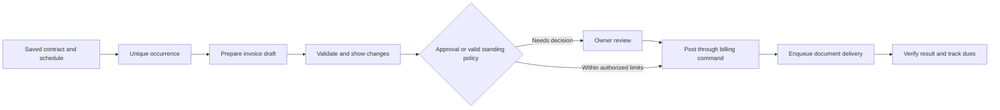
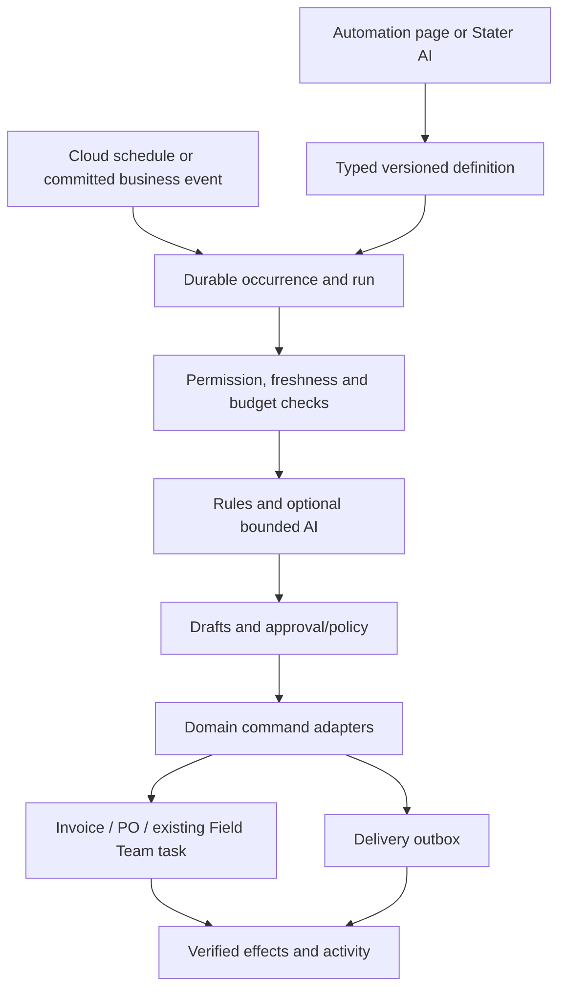

# STATER Bill: agentic billing and everyday automations

Date: 11 November 2026 (Asia/Calcutta)

Status: implementation proposal grounded in the current repository. This document plans the Automation page, recurring work and execution engine; it does not enable background actions or change production data.

Commercial authority: [pricing, credits and Local/Pro decisions](2026-11-11-STATER-PRICING-AUTOMATION-AND-MOBILE-PLAN.md). One Pro includes automation, with a monthly AI allowance and recharge packs. There is no separate automation subscription.

## 1. Product outcome and launch promise

**STATER Bill — Agentic billing for growing businesses.**

The owner describes an outcome once. STATER prepares the work, runs approved steps on schedule, notices exceptions and brings back the few decisions that need the owner.

Examples:

- “Prepare monthly bills for these maintenance customers on the first. Show me price changes before posting.”
- “Every morning, prepare today's collections and assign Ravi the shops on his route.”
- “When stock falls below my minimum, group a purchase proposal by supplier and ask me before sending.”
- “At closing, show unpaid bills, incomplete deliveries and cash differences that need attention.”

Initial audience: Indian retail/wholesale businesses using Billing and Field Team, with a fixed-price service/repeat-customer pilot for recurring invoices. Industry packs can follow once the same execution foundation works reliably.

The differentiator should be a complete **bill → collect → replenish → assign → verify** loop using the business's actual catalogue, three price tiers, stock, dues and staff work. Measure completed outcomes and exceptions resolved. Keep the fast barcode/POS path available without waiting for an AI call.

Avoid an unqualified “first AI agentic billing software” claim. Zoho already documents agents that create sales transactions and voice-assisted interactions; QuickBooks markets accounting agents and recurring invoicing. Build a demonstrably strong workflow and use the positioning above. Sources: [Zoho AI features](https://www.zoho.com/us/books/help/ai-features/ai-features.html), [QuickBooks Accounting AI](https://quickbooks.intuit.com/global/ai-agents/accounting).

### What makes this agentic

1. Understand a requested outcome and resolve missing business context.
2. Turn it into an inspectable, saved workflow with concrete records, permissions and limits.
3. Use business tools to prepare or perform authorized work.
4. Wait for approval, due time, synchronization or another service when required.
5. Resume from the recorded step, verify the outcome and escalate exceptions.

AI interprets language, extracts documents, maps uncertain inputs and explains exceptions. Code owns schedules, quantities, totals, taxes, permissions, posting and duplicate prevention. A fixed monthly rule does not need to call an AI model on every occurrence.

## 2. Current foundations and implementation gaps

These are repository findings, not verification of a deployed service.

| Foundation in the app | Evidence | Reuse / work required |
| --- | --- | --- |
| Deterministic sale and payment commands | `backend/core/billing/commands.py`: `create_sale_invoice`, `record_payment`, `settle_customer_dues`; `commit=False` composition | Use the same commands as manual billing. Add durable automation effect/result records in the same transaction. |
| Stock and accounting posting | `backend/core/stock/ledger.py`, `backend/core/accounting/posting.py` | Preserve stock, receipts, journal, period-lock and tenant rules. Agents never update these balances directly. |
| Preview-bound AI action confirmation | `backend/routes/actions.py`, `services/action_rails.py`; `frontend-ai/src/components/ActionConfirm.jsx` and `pages/Chat.jsx` | Keep exact-preview confirmation for interactive actions. Add durable approvals and explicit standing policies for scheduled work. |
| Bounded AI reasoning/tool loops | `backend/services/agent_loop.py`, `agent_graph.py` | Reuse as an intelligence layer. Their current tool loop is not a persistent recurring write executor. |
| Durable cloud cron | `backend/services/cron_runner.py`, `database/runtime_state.py`, `routes/internal_cron.py`, `ops/cloud-scheduler-jobs.json` | Existing fixed jobs have job/period keys, leases and business cursors. Extend this pattern to merchant-defined occurrences. Cloud scheduling is already durable; older process-only descriptions are incomplete. |
| Daily summary, overdue, stock and expiry alerts | `backend/services/alert_jobs.py`, `services/scheduler.py` | Turn useful signals into shared selectors/templates; reconcile existing alerts to avoid duplicate owner notifications. |
| Email | `backend/services/notifier.py` | SMTP exists. WhatsApp is not implemented by the current `notify` argument; expose only genuinely connected channels. Add delivery outbox/status tracking. |
| AI usage limits | `backend/database/models.py`: `TokenUsage`; `services/rate_limiter.py` | Metering exists; a rechargeable balance with reservations, debits, refunds and purchase history still needs implementation. |
| Supplier invoice extraction/confirmation | `backend/core/api/purchases.py`, `core/purchase/commands.py` | Reuse extraction and purchase validation. Posting a purchase is separate from reading a document. |
| PO data tables | `backend/database/models.py`: `PurchaseOrder`, `PurchaseOrderLineItem` | Tables exist; a normal end-to-end create/send/partial-receive PO lifecycle still needs services/API/UI. |
| B2B ordering | `backend/core/order/service.py` | A supported supplier adapter, with existing seller/buyer financial effects. Add operation deduplication before scheduled creation. |
| Field tasks and weekday route templates | `backend-task/app/models.py`, `routers/tasks.py`, `routers/runs.py`; `frontend-task/src/pages/owner/*` | Reuse general, delivery and collection tasks. Route generation is currently manually requested; add occurrence uniqueness and scheduled execution. |
| Automation page | Billing `src/App.jsx`, `layouts/AppLayout.jsx` | No Automation route or saved workflow system currently exists. Stater AI Activity source exists but is not routed as a shipped activity page. |

### Important gaps to close before unattended work

- **Pending invoices are already posted.** They have stock/accounting consequences. Create separate `InvoiceDraft` and `BillingTemplate` records; do not use Pending as a draft state.
- Current `draft_reorder_po` logs recommendations from legacy `Inventory` rows. It neither creates a real PO nor uses the full normalized product/stock definition. Unify selectors first.
- Current status-only `mark_invoice_paid` action is deliberately blocked. Keep it blocked; use actual receipt/allocation commands.
- Current HTTP replay handling caches a response after execution. It does not alone prevent two concurrent commands or a retry after a commit/response crash.
- Some reminder paths send email before committing a log; concurrent runs or a crash can resend. Add per-recipient durable effects and provider reconciliation.
- Existing action caps use a count-before-execution check and can fail open. Automated fan-out requires atomic recipient/spend reservations and blocking on uncertain budget state.
- Existing cron uses IST periods while some action caps/dedup use UTC. New recurrence and contact cooldowns need one explicit merchant-timezone policy.
- Field route generation checks for an existing day in application code without a corresponding uniqueness constraint. Add a durable occurrence key before scheduling it concurrently.

## 3. First workflows and the daily operating loop

“Rules” below means deterministic execution with no AI credit charge. AI is optional where shown. All templates show required setup, execution location and approval mode before activation.

| Template | Trigger and result | AI contribution | Initial execution policy |
| --- | --- | --- | --- |
| Morning business briefing | Business opening time → sales/dues/stock exceptions and today's work | Optional short explanation in the owner's language | Automatic owner-only summary after activation; rules-only version available |
| Repeat customer bills | Daily/weekly/monthly contract occurrence → invoice drafts | Understand initial instruction; explain changed items | Draft automatically; owner approves posting/sending |
| Collections worklist | Every weekday → live dues grouped by customer, staff tasks and reminder drafts | Optional wording/priority explanation | Tasks within chosen assignee scope; external messages reviewed |
| Opening/closing checklist | Shift or selected time → general staff tasks, due time and evidence requirement | Optional setup from a sentence | Automatic task assignment; staff still completes the work |
| Prepare today's route | Saved route weekdays → assigned route run and stops | No AI needed | Automatic after destination deduplication is implemented |
| Low-stock purchasing | Daily or a stock threshold crossing → supplier-grouped PO drafts | Explain alternatives or uncertain supplier mapping | Draft for review; approved submission only after real PO lifecycle exists |
| Supplier bill review | User uploads a bill → extraction, product/PO match and discrepancy list | OCR and ambiguous matching | Review before purchase/stock/account posting |
| Closing exceptions | Closing time → unclosed shifts, overdue tasks, missing receipts and purchase discrepancies | Optional narrative summary | Owner notification; no automatic cash adjustment |
| Order-to-bill preparation | Customer order/approved quote → bill draft using actual items and agreed prices | Parse text/voice/document order | Review quantities, price tier and stock before posting |
| Delivery and collection handoff | Posted invoice → delivery/collection task linked to that invoice | Optional task note | Only selected staff/routes; no automatic delivery or receipt completion |
| Expiry and stock-count work | Threshold or periodic count → review/count tasks | Summarize exceptions | No automatic stock write-off or price change |
| Weekly business review | Weekly close → movements, receivables, aging purchases and exception backlog | Grounded interpretation | Owner-only; source links for every metric |

**Ordered template roadmap:** the first eight, delivered in the slices below. The A–C private pilot exposes only the completed briefing, repeat-bill and staff-work templates. Mark each other template Planned until its services and release gates pass; it cannot be activated. Order-to-bill, delivery handoff, stock-count and weekly review expand the same runtime rather than introducing separate agents/services.

A useful owner day should feel like this:

| Time | STATER prepares | Owner/staff does |
| --- | --- | --- |
| Before opening | Briefing, route work and due checklists | Reviews the small exception list |
| During billing | Converts a spoken/text order into an editable bill and validates catalogue matches | Confirms ambiguous items and actual payment |
| During the day | Prepares repeat bills, collection drafts and supplier proposals | Approves changes or delegates work |
| After a staff collection | Links evidence and current invoice balances | Owner confirms receipt allocation through existing collection flow |
| Before closing | Brings back unclosed shifts, unmatched money and incomplete work | Resolves exceptions; confirms physical cash where relevant |

## 4. New Automation page

### Location and visual direction

Build the authoritative hub inside Billing at **`/automations`**. Add an owner-visible sidebar entry near Stater AI and register it in universal search/help. Keep the current five mobile bottom destinations; reach Automations from the drawer, search and review notifications.

Use the current terracotta accent, warm neutral surfaces, typography and outlined mobile shell. Keep the screen operational: modest header, readable rules, next action and outcome. Avoid a large decorative hero consuming the working area.

Stater AI can propose a workflow and open its saved definition in this hub. Field Team receives assigned tasks and links back to the originating run. There is one workflow definition and one run history across apps.

### Hub layout

```text
Automations                         [Create automation]
Keep everyday business work moving

[Needs review] [Scheduled next] [Needs attention] [AI credits]

My automations | Approvals | Activity | Templates

Monthly customer bills                    Active · Review before posting
Every month, 1st at 09:00 → prepare bills for 12 selected customers
Next: 1 Dec, 09:00 IST     Last: 12 drafts prepared     [Open] [Pause]

Opening checklist                         Active · Automatic tasks
Weekdays, 08:30 → assign opening work to selected staff
Next: tomorrow, 08:30      Last: 5 tasks assigned       [Open] [Pause]
```

- Summary tiles open filtered lists; they show real records, not invented benefit counters.
- Each row/card shows readable rule, scope, mode, next run, last outcome, owner and pause action.
- Filters: type, active/paused/setup, execution mode, assignee and attention reason.
- Details contain **Overview · Workflow · Runs · Settings** with version and change history.
- Activity defaults to meaningful exceptions and recent outcomes; completed no-op checks can be collapsed.
- Display measured drafts, posted invoices, assigned/completed tasks and delivered messages. “Time saved” may be shown only as an explicitly estimated metric with a documented baseline.

Definition states: **Draft / Active / Paused / Needs setup / Archived**. Run states: **Scheduled / Running / Awaiting approval / Waiting / Completed / Partially completed / Skipped / Failed / Cancelled**. A Waiting state names its reason: synchronization, credits, provider connection, approved time or dependent step. Zero matching records is a successful skipped/no-op outcome, not an error.

### Create automation: a guided form

The B/C pilot starts from **Use a template** and guided forms. Add **Describe your work** with starter prompts only after slice E's language evaluation and wallet gates pass; do not display an apparently usable language builder before it exists. Both entry points ultimately produce the same typed definition.

1. **When:** manual/event/schedule; timezone, start/end, repeat count, holidays/weekdays, next three occurrence previews.
2. **Which records:** choose actual customers, catalogue items, supplier, godown, staff and filters. Explain selected/excluded record counts.
3. **What happens:** choose supported actions and their outputs; allow a small ordered sequence with a conditional branch. Advanced branching follows later.
4. **Your controls:** Draft only / Review before action / Automatic within approved limits; amount, quantity, customer, recipient and daily limits; approval expiry and contact hours.
5. **Test and activate:** simulate with sample/current read-only data; show records, amounts, recipients, missing fields, exclusions, estimated AI credits and next run. Resolve required setup before activation.

Natural language fills the same typed form. “My regular customers” requires a selected saved group; “send it monthly” requires a day/time/channel. Show the interpreted schedule and choices before saving. A low-confidence answer asks a short, specific question. Never silently invent a customer, tax, quantity, price or contact destination.

Suggested simple expression:

**When** every Monday at 8:30 AM, **for** these customers, **prepare** collection tasks, **assign** Ravi, **ask me** before sending reminders.

For complex workflows, show a vertical readable story: **When → Find → Check → Prepare → Review → Do → Verify**. A desktop node canvas may become an advanced view later; it must not be required to set up ordinary daily work.

### Test mode

Simulation does not post, decrement stock, send messages, assign real work or consume legal invoice numbers. Show “Would prepare 12 drafts; 2 need review,” with exact examples and exclusion reasons. An optional AI-assisted simulation shows its estimated charge before running; rules-only simulation is free of AI credits.

Use the preview/test principle documented by [Shopify Flow](https://help.shopify.com/en/manual/shopify-flow/manage/test-workflow): verify logic and output before activation without changing live records. STATER's proposed business controls and UI are its own design.

### Approvals

- One inbox across invoices, POs, reminders and collection exceptions, filtered by permission.
- Show exact customer/supplier, lines, quantity/unit, price tier, totals, source and changes since the last bill.
- Separate **Post invoice**, **Send invoice/message**, **Submit PO** and **Confirm receipt** where these are distinct effects.
- Show the exact recipient/channel/attachment/message for a send. A posted bill does not imply approval for every delivery channel.
- Allow exclusions, edits, reject, snooze and “skip this occurrence.” Do not hide unchecked records behind a bulk approval.
- Editing material fields regenerates the preview. A changed price, recipient, stock constraint, balance or workflow version invalidates affected approval.
- Check current permission, subscription, policy and material data again at execution. Display a difference if approval has become stale.
- Record the approver, approved version/hash, expiry, scope and reason. Present a short evidence-based explanation, not internal model reasoning.

### Run details and recovery

Show a timeline: trigger → selected records → checks → prepared outputs → approval → action → delivery/verification.

Every step links its input/source and resulting invoice, PO, message or task. Show started/completed time, retries, actual AI charge and the next required action. Examples: “Invoice posted; email delivery needs reconnection,” “Skipped: customer has already paid,” “Waiting for stock sync.”

Retry resumes only eligible failed steps. Sending an invoice again never reposts it. A changed financial payload requires a new preview rather than reusing a previous command key.

### Mobile and required screen states

- Single-column cards, 44px controls, short readable summaries, full-height builder/review sheets and a vertical run timeline.
- Back / Continue stays within the safe content area above the existing bottom bar; long previews scroll independently of their action footer.
- Empty: three relevant starter templates and a sample workflow, with no fake live activity.
- Loading: skeletons preserving layout; retain a user's unsaved builder entries after recoverable errors. An offline local draft says “Saved on this device; activation requires connection”; do not imply it is activated on the server.
- Needs setup: name missing catalogue/staff/contact/provider data and link to fix it.
- Waiting for sync: show affected source/device, last successful sync and a resume path.
- Insufficient AI credits: show the blocked AI step and estimated requirement; deterministic steps remain available where independent.
- Provider disconnected: “Reconnect email”; preserve posted document and pending delivery.
- Local subscription: explain Pro capability and show a sample template preview; enforce access server-side.
- Demo: protected sample workflows and simulated run history only; no connection setup or live execution.
- Error/partial result: preserve successful effects, explain the failed step and provide a targeted retry/review action.

## 5. Billing automation in detail

### A. Assisted billing at the counter

Inputs: typed order, voice transcript, customer document or approved order/quote. Match customer, catalogue product, variant, unit, price tier and location against actual business records. A product alias can be learned from an owner correction within that business.

Return an editable bill draft with evidence for matches and clear unresolved choices. Reuse current invoice math for tax-inclusive/exclusive prices, discounts, round-off and totals. Check serial/batch requirements, permissions, negative-stock policy, credit terms and period locks through existing services.

Example: “Ramesh, two rice bags and six tea packets at wholesale.” If multiple Ramesh contacts or bag sizes match, request the choice. Do not silently pick an account or convert packet quantities. Owner/cashier confirms actual tender using the normal checkout. No AI answer is evidence that cash or UPI was received.

POS typing/barcodes remain immediately usable. Optional AI preparation runs alongside the existing bill, with a clear replace/merge preview to prevent duplicate lines.

### B. Recurring invoice lifecycle



`BillingTemplate` stores stable customer/product UIDs, agreed quantity/unit, price policy, tax mode, payment terms, godown/counter scope, service period and recurrence. The contract price policy explicitly chooses fixed agreed price versus current permitted catalogue tier. Changes beyond agreed tolerance require review.

`InvoiceDraft` stores the proposed document and validation state. Drafts do not affect stock, receivables, tax reports or accounting; they do not allocate a final invoice number. Keep a separate draft reference.

At posting, revalidate live data, allocate the final number through the canonical sequence and commit invoice, stock, journal, effect record and output reference together. Service lines follow the app's existing service semantics; physical goods retain delivery, serial/batch and stock checks. First release supports fixed contracts; variable consumption, proration, usage billing and inferred deliveries follow explicit later design.

Recurring dates must define monthly day 29/30/31, last-day behaviour, leap years, business timezone, start/end/count, weekends, missed occurrences and cancellation. Preview the next three dates. Keep the contractual period distinct from a shifted execution date. Skipping one bill must not delete the contract.

An outage never silently generates and sends months of backdated bills. Default to a bounded missed-occurrence review, with the owner choosing which drafts to prepare. Posted invoices use the established correction/credit-note process; changing a future template does not rewrite history.

This draft/finalize distinction follows a well-established invoice lifecycle; see [Stripe invoice states](https://docs.stripe.com/invoicing/integration/workflow-transitions). It is a design reference, not a proposed requirement to adopt Stripe or change STATER's payment provider.

### C. Receipts and collection reminders

Calculate current dues through canonical balance services; exclude settled, credited, disputed, opted-out or recently contacted accounts. Recheck balances immediately before contact or collection assignment.

Start with reviewable messages over a configured email channel. Add cooldown, contact hours, recipient verification and maximum escalation frequency. WhatsApp/SMS/phone are separate integrations with delivery callbacks and their own costs; label them unavailable until implemented.

A payment screenshot, customer message or staff task completion creates evidence or a review item. Actual payment status changes only through `record_payment`, `settle_customer_dues` or the existing owner-confirmed field-collection command. Future provider webhooks require signature verification, event deduplication and reconciliation; events may arrive repeatedly or out of order. [Stripe's webhook guidance](https://docs.stripe.com/webhooks) documents these behaviours for its provider and is a useful integration reference.

### D. Purchasing loop

Use normalized products, godown stock, reserved quantities and remaining confirmed inbound PO quantities. Aggregate by product, then group by supplier. Distinguish a threshold-based recommendation from a forecast; demand/lead-time forecasting needs sufficient sales history and actual supplier lead times.

PO stages: draft → approved → submitted → acknowledged → partially received → received/closed, with cancellation and exception states. Show unit/pack conversions, price differences, tax, supplier, budget and expected delivery. Submission must be a real provider/B2B/email operation with a document and recorded result.

Track each received quantity and its source. Supplier invoice confirmation must not receive the same stock a second time. Reuse purchase/accounting commands and the B2B service where appropriate; add explicit adapters for their current internal commits and duplicate handling.

OCR/matching creates a reviewable purchase draft. Missing products, changed rates, extra quantities, duplicate invoice numbers and mismatched PO totals go to exceptions. No automatic supplier payment, bank transfer or unsupported ledger adjustment is part of this launch.

## 6. Recurring staff work and owner reviews

Use existing Field Team tasks for general checklists, delivery and collection work. Use existing route templates for planned visits. Keep distinct adapters for a general recurring task and a weekday route run; one does not replace the other.

Current Field Team task creation requires a real FieldStaff assignee and completion requires staff authorization. For v1, owner work appears as Billing reminders/review items; do not create a fake staff account for the owner or imply an owner can complete a FieldTask. Owner-completable assigned checklists need a separately designed assignee/completion model. Billing cashiers appear in the Field Team selector only after an explicit, verified identity mapping.

Task templates contain title, instructions, active assignee, due time, optional shop/invoice links and the completion evidence supported by that task type. Define holidays, staff absence/reassignment, escalation and whether an unfinished prior occurrence blocks or coexists with the next.

Suggested policies:

- Opening/closing checks: create one per selected workday/shift; never mark done just because time passed.
- Route preparation: one run per business/route/service-day; skip inactive routes and unavailable staff with an owner exception.
- Collection: update the expected balance from live invoices; stop reminders when paid; preserve owner receipt confirmation.
- Stock counts: create count work; propose adjustments only after evidence/review.
- Overdue tasks: notify the assignee, then owner after the chosen interval; avoid a repeated notification every scheduler tick.

Do not award points or bypass existing attendance, location, delivery and completion checks during task generation. Link each task to its automation/run/occurrence so the owner can trace why it exists. Task completion may emit a new business event but cannot cause an unbounded automation loop.

## 7. Execution modes and authority

| Mode | Behaviour | Release policy |
| --- | --- | --- |
| Draft only | Prepare documents or suggestions; owner acts manually | Default for financial templates at launch |
| Review before action | Prepare work, request exact approval, execute and verify | Initial posting/submission/customer-contact mode |
| Automatic within limits | Execute only a supported action covered by an explicit owner policy | Start with internal tasks/owner summaries; expand per action after pilots |

A standing policy specifies owner, allowed action, named record scope, amount/quantity/recipient caps, validity period, execution location and exception rules. It is versioned, revocable and auditable. Editing material scope requires renewed authorization. Never manufacture a fresh interactive confirmation token to impersonate future owner consent.

Invoice posting, external sending, receipt recording and stock adjustment have separate capabilities. A workflow creator cannot approve above their limit. Revalidate role, business status, subscription and delegation when a run resumes; revocation stops pending work. Workers use tenant-scoped service identities rather than saved owner browser sessions.

Uploaded supplier documents, emails and voice transcripts are untrusted business input. They cannot change tool permissions, workflow policies, recipient allowlists or system instructions. Allow only registered actions with validated schemas; avoid arbitrary SQL, shell execution and open-ended external URLs.

## 8. Runtime and data architecture

Use one shared Automation Runtime in the Billing backend. Start with a bounded typed workflow interpreter and existing infrastructure; specialist AI graphs produce plans/arguments but do not own transaction boundaries. A new orchestration vendor is not required to launch the first workflows.



### Persistent records

| Record | Essential purpose |
| --- | --- |
| AutomationDefinition | Business, name, owner, active revision, state, trigger, timezone, next occurrence, execution authority |
| AutomationVersion | Immutable typed trigger/conditions/steps/policy, compiler version, author and change history |
| AutomationRun | Logical occurrence/event key, pinned revision, source/freshness snapshot, state, lease/fencing token and outcome |
| AutomationStepRun / Effect | Step/target key, exact payload hash, retries, external reference or resulting document UID; commit proof |
| AutomationApproval / PolicyGrant | Exact preview hash, approver, allowed scope/limits, expiry, status and revocation |
| BusinessEvent / Inbox | Transactional source event UID, business, entity/version and consumer checkpoint/dedup |
| ExternalEffectOutbox | Destination, payload/attachment reference, idempotency key, attempt/receipt/delivery/unknown state |
| BillingTemplate / InvoiceDraft | Contract, period and proposed bill, validation, approval and final invoice reference |
| AI credit ledger / reservation | Run-linked balance movements, reserved/measured usage, settlements and refunds |

Reuse existing ActionLog, TokenUsage, cron job records and outbox patterns where appropriate. Do not overload sync replication queues as a generic email queue. Add explicit links rather than duplicating records across apps.

Every record is tenant-scoped. Cross-device/service references use stable UIDs, not assumed-equivalent numeric database IDs. Database constraints and indexes enforce business/occurrence/effect uniqueness and efficient due-run claims. Keep sensitive connection credentials server-side and out of workflow JSON/model prompts/logs.

### Scheduling, events and concurrency

- Add a bounded dispatch job to the existing authenticated cloud cron entry point. It claims due occurrences and persists runs before handing off execution.
- Store schedules in merchant timezone and timestamps in UTC. Persist intended occurrence, next run and missed-run policy. Do not create one in-memory timer per merchant.
- Use database compare-and-set claims, renewable leases and fencing tokens. An expired worker cannot finish a step after another worker has taken ownership.
- Keep long AI/provider work outside database transactions. Record intent/claim first; commit final local effect/result atomically, or dispatch a deduped remote command through an outbox.
- Inside the final local financial transaction, atomically verify the current lease/fence, workflow activation and current authorization/policy before committing. Remote destinations also validate current authority/delegation epoch at execution, beyond checking duplicate keys. Pause/revocation therefore blocks a stale worker's first late effect as well as its retries.
- Record business events alongside committed sale/payment/stock/task changes. SSE/browser notifications may update the UI but are not durable automation triggers.
- Apply causation/run IDs, cooldowns, bounded fan-out and maximum chain depth to prevent one workflow repeatedly triggering itself or another.
- Run bounded batches with per-business fairness. Start using the current durable dispatcher; add a dedicated managed task queue/worker when load or execution duration justifies it. Do not rely on a request still running after Cloud Run returns.

Cloud Scheduler explicitly permits repeated delivery, and Cloud Tasks also documents duplicate execution. STATER must deduplicate its business effects regardless of the chosen worker transport. Sources: [Cloud Scheduler](https://docs.cloud.google.com/scheduler/docs/overview), [Cloud Tasks limitations](https://docs.cloud.google.com/tasks/docs/common-pitfalls).

### Duplicate prevention: key design

**Schedule occurrence:** unique `(business_uid, automation_uid, logical_occurrence_key)`.

**Event run:** unique `(business_uid, automation_uid, source_event_uid)`.

**Effect:** unique `(business_uid, run_uid, step_uid, target_uid)` bound to the exact payload hash, with its committed output reference.

Pin the workflow revision on a run, but do not make a new revision sufficient to create a second copy of the same contractual occurrence. Editing a schedule needs an explicit effective-from/cutover. Add a contract-period uniqueness rule for repeat billing so two overlapping definitions cannot accidentally bill the same contract twice. A deliberate supplementary bill requires a distinct, reviewed business operation.

For local commands, persist effect/result and invoice/payment/task changes in the same transaction. For another service, persist dispatch then require destination-side uniqueness and an operation-result lookup. Resolve the “committed, response lost” case before retrying. Treat changed payload under an old key as a conflict. [Stripe idempotency](https://docs.stripe.com/api/idempotent_requests) is a useful reference for retry-key/payload semantics.

A provider accepting an email is different from verified delivery. Record queued/accepted/delivered/bounced/failed/unknown separately. If a provider lacks idempotency or receipt lookup, reconcile uncertain sends or request review; do not promise exactly-once external delivery.

### Local and cloud behaviour

- Connected Pro automations run in the cloud when the app is closed, using cloud-confirmed data and one assigned executor per occurrence.
- Show the source and freshness of affected data. Define per-action freshness thresholds; stale physical stock or unresolved financial conflicts block automatic posting/submission and create a review item.
- An explicit Local Only choice remains respected. That device's unsynchronized changes cannot silently power cloud decisions. Pause/hold affected cloud-dependent actions until required data is available.
- The UI must distinguish a device's sync setting from business-wide workflow activation. Owner-only cloud-data tasks can continue only within their declared cloud scope; do not silently assume they include disconnected device activity.
- Do not add an independent desktop scheduler that posts the same cloud workflow. Future local execution requires an assigned device, authority epoch, offline entitlement and stable occurrence/effect keys before launch.
- Keep local-only scheduling outside the initial release. The Local plan keeps its core paid billing features; connected automation is part of Pro.
- A posted invoice awaiting delivery stays posted after an outage. Resume delivery separately. Reconnection never replays successful financial effects.

## 9. AI credits, cost and sustainable pricing

Follow the existing one-Pro plan. Workflow setup via a template, deterministic recurrence, calculations, threshold checks, task assignment and standard reports consume no AI credits. AI interpretation, OCR, custom reasoning and voice consume credits at published rates.

At creation/test show which steps use AI and an estimated range. Set a per-workflow maximum, per-run limit and business-wide monthly cap. Reserve budget atomically before a model/provider call; settle measured usage against a versioned rate card, release unused reservation and link the debit/refund to the run. Included and purchased balances remain distinguishable.

At zero credits, pause only dependent AI steps. A compiled fixed-price recurring rule or independent checklist can continue under active Pro. Offer a rules-only fallback where meaningful, recharge or resume after allowance renewal. Never fabricate a successful result because an AI step was skipped.

Use saved templates and aliases, typed selectors, delta triggers and batched summaries to reduce cost. Avoid repeated full-catalogue prompts, polling AI for unchanged conditions and one expensive model call per invoice line. Bound token/tool/time/recipient counts and retries. Model choice is an evaluated implementation decision; the plan does not require a new provider.

For voice: start with push-to-talk → editable transcript → supported action preview, including product/unit disambiguation. Outbound agent phone calls, call transfers and long-running conversations are later work with separate telephony costs, channel setup and authorization. Do not market unsupported voice languages or automatic phone collections.

## 10. API and integration contract

Proposed API surface; these routes are not implemented yet:

| Endpoint | Purpose |
| --- | --- |
| `GET /automations/catalog` | Available typed triggers/actions/templates, required permissions and setup |
| `POST /automations/interpret` | Optional AI instruction → validated draft definition + unresolved questions |
| `POST /automations/validate` | Schema, record scope, entitlement, recurrence and setup checks |
| `POST /automations/simulate` | Read-only selected/excluded records, intended effects and cost estimate |
| `GET/POST /automations` | List/create a saved definition |
| `GET/PATCH /automations/{uid}` | Details and versioned draft edits with optimistic concurrency |
| `POST /automations/{uid}/activate`, `/pause` | Explicit state transition and policy validation |
| `POST /automations/{uid}/run` | Authorized manual occurrence with a stable request key |
| `GET /automation-runs`, `/{uid}` | Filtered activity and step/evidence/output details |
| `POST /automation-runs/{uid}/cancel`, `/retry` | Cancel pending steps or resume eligible failed work |
| `GET /automation-approvals` | Permission-filtered review inbox |
| `POST /automation-approvals/{uid}/decision` | Approve/reject/exclude with bound preview and version |
| Internal dispatch/worker routes | Authenticated occurrence claim and execution; no ordinary user cron access |

Return structured states, reason codes, human-readable next action, source/output links and cost metadata. Publish optimistic version checks and stable request-key semantics. Avoid exposing raw prompts, model reasoning or connection secrets in API responses.

### Likely code changes

- Billing UI: `frontend-billing/src/App.jsx`, `layouts/AppLayout.jsx`, `config/searchIndex.js`, `config/helpContent.js`, notification/deep-link integration and authoritative capability handling.
- New UI: `pages/Automations.jsx`, `AutomationEditor.jsx`, `AutomationRun.jsx`, `components/automation/*`, `hooks/useAutomations.js`, a small API adapter and scoped responsive CSS.
- Stater AI: reuse chat preview/confirm patterns; propose automation drafts and deep-link to the hub. Route or replace the currently unwired Activity source rather than maintaining competing histories.
- Backend: an automation package for schemas/catalogue, selectors, recurrence, compiler, runtime, approvals, command adapters, delivery, budgets and audit; additive migrations for the records above.
- Financial adapters: compose canonical billing commands with effect persistence; normalize stock selectors and expose complete PO commands. Refactor internal-commit seams deliberately with existing regression coverage.
- Field Team: add destination idempotency/occurrence constraints, authenticated command/result contracts and “Created by automation” source/run links. Reuse existing task completion and receipt-confirmation semantics.
- Admin: business/run health, per-feature kill switches, provider/queue failures and credit reconciliation. Support access must be scoped and audited; no unrestricted customer-data browsing as an automation feature.

## 11. Delivery sequence and release gates

Ship vertical slices with real end-to-end outcomes. Do not build all agent personas or a large visual canvas before the first reliable recurring bill.

Sequence refinement from the earlier pricing plan: use the small recurring-billing/daily-work private pilot to prove the shared runtime first. Purchasing remains the first complete purchasing-agent workflow and retains its draft → review → approve → send → track completion requirement; this changes delivery order rather than claiming PO work is already implemented.

| Slice | Deliverable | Release gate |
| --- | --- | --- |
| A — shared foundation | Versioned definitions, tenant capabilities, occurrence/effect uniqueness, durable worker, approvals and audit, basic credit reservation contract | Concurrent dispatch/restart produces one recorded effect; exact preview and revocation checks pass |
| B — Automation hub and first daily work | Hub/builder/simulation/activity, rules-only daily briefing and staff checklist/route preparation | Owner can create/test/pause a workflow on phone and desktop; no duplicate tasks or owner alerts |
| C — recurring billing | Contracts/drafts, date policies, preview changes, approve/post, document delivery and separate retries | One contract period creates one bill; drafts have zero stock/accounting effects; changed data returns to review |
| D — collections and purchasing | Live-dues reminder workflow, field collection handoff, normalized reorder and real PO lifecycle | Paid balances suppress reminders; purchase receipt/invoice cannot double stock; partial provider failures recover |
| E — language and bounded autonomy | Plain-language builder, order-to-bill input, push-to-talk, eligible automatic policies | Evaluations cover ambiguous catalogue/units/languages; automatic scope proven per action; caps and wallet work under retry |
| F — pilot and expansion | Industry packs, richer events/branches, usage-informed defaults and measured ROI | Pilot reliability/cost/retention gates met before marketing broader autonomy |

Start the private pilot with **daily briefing + recurring invoice drafts + daily staff tasks** once A–C gates pass. Add autonomous posting/customer contact only for explicitly supported, tested, bounded policies. PO/voice are separate completion gates; their presence in a template gallery must not imply availability.

Indicative sizing: A–C is a multi-sprint effort; D–F add substantial purchasing, provider and evaluation work. With one primary engineer plus part-time design/QA, use an initial 8–12 week planning envelope for the first coherent pilot and hardening, then re-estimate after A. This is an estimate, not a committed release date. Broad outbound calling and unrestricted agent actions are outside that envelope.

### First implementation backlog

1. Define supported action schemas, permission matrix, state machines and domain-command transaction boundaries.
2. Add migrations for definitions/versions, logical occurrences/runs, steps/effects and approvals; add contract-period/task-route uniqueness.
3. Implement claim/retry/fencing and transactional event/outbox patterns; exercise crash boundaries before enabling customer sends.
4. Add scheduler occurrence previews including month-end, timezones and missed-run policies.
5. Build catalogue and deterministic simulation endpoints; validate all selected record IDs against the business.
6. Build the hub, template wizard, approval inbox and run timeline with protected demo fixtures.
7. Implement internal checklist/briefing adapters and destination-deduped Field Team task creation.
8. Implement BillingTemplate/InvoiceDraft and exact preview; post through canonical commands with committed effect references.
9. Implement document delivery and recoverable provider states; preserve successful posting on send failure.
10. Add the real credit wallet/reservations before paid AI workflows; keep deterministic pilot flows independent.
11. Pilot read-only/draft flows, record corrections, then graduate individual actions to reviewed execution.
12. Complete purchasing, collections channels and voice one vertical slice at a time; update product claims only after verification.

## 12. Validation and operational measures

Extend existing billing/stock/payment, action confirmation, cron, token-accounting, sync and Field Team suites. Focus on outcomes and failure boundaries rather than tests that mirror the new implementation.

Required cases:

- Same schedule/event delivered twice, concurrent workers, lease loss, crash after database commit and response loss: one business effect and the same output reference.
- Revision change at the same occurrence, overlapping contracts/rules, timezone change and schedule cutover: no accidental second invoice/task.
- Draft preparation: no final invoice number, stock, journal, balance or report change.
- Stale approval, changed recipient/price/balance, revoked staff, expired Pro/policy and cross-tenant IDs: block affected execution and explain the next action.
- Month-end/leap year, DST in supported timezones, holidays, outage, skip, pause, resume and cancellation: preview agrees with execution.
- Source payment before reminder, partial receipt, credit note, disputed invoice and opted-out recipient: correct current decision.
- Product/unit ambiguity, serial/batch constraints, insufficient stock, duplicate supplier document and partial PO receipt: review without inconsistent posting.
- Destination task command retried; staff absent/inactive; existing unfinished occurrence: no duplicate work or fabricated completion/points.
- Crash after provider acceptance, missing callback, bounce and provider outage: preserve result uncertainty and avoid blind resend.
- Fan-out larger than remaining cap; simultaneous AI reservations; retry/refund; purchased/included balance: no overspend or duplicate customer debit.
- Explicit Local Only, stale sync, concurrent desktop/cloud activity and reconnection: one authority and no replayed financial effect.
- Document prompt injection, malicious webhook payload, invalid tool arguments and runaway trigger chain: no expanded permissions or unrestricted actions.
- 320/390/430px, desktop, keyboard, screen reader, long names/amounts, independent scrolling and reduced motion: creation and review remain usable.

Pilot measures: automation activation/completion rate, drafts accepted versus edited, exception resolution time, task completion, due follow-up outcomes, provider delivery, AI cost per successful outcome and subscription contribution. Label correlations rather than attributing every paid invoice to an agent.

Operational release requirements: run age/backlog dashboard, failed/unknown external effects, lease recovery, credit ledger reconciliation, source-sync freshness and per-business/action pause switches. A pause stops future and not-yet-committed effects; it cannot undo a posted invoice or already delivered message. Existing correction/recovery processes remain available.

Target the first 10–20 pilot businesses, with owner-reviewed financial actions and realistic outage/concurrency drills. Advance based on reliable completed work and measured costs. Do not publish unsupported absolute claims such as “zero errors,” “copy proof,” “fully autonomous accounting” or “guaranteed revenue recovery.”

## 13. Immediate decision

Build the shared foundation and the Automation hub first, and prove three complete workflows: **prepare my daily work, prepare my repeat bills, and assign my staff work**. Then extend the same engine through collections and purchasing, followed by natural-language/voice setup and carefully bounded automatic execution.

The desired owner experience is simple: **Tell STATER once. Review what needs you. See the work completed.**
